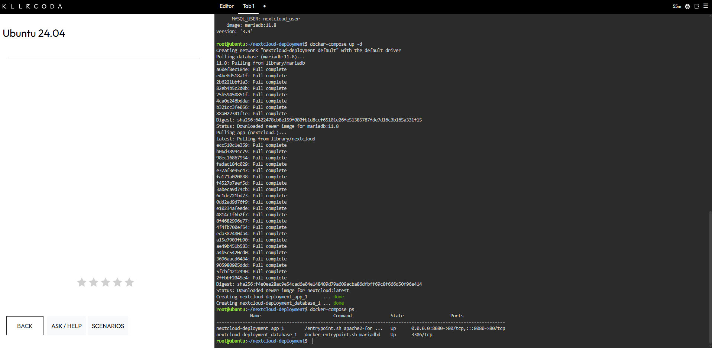
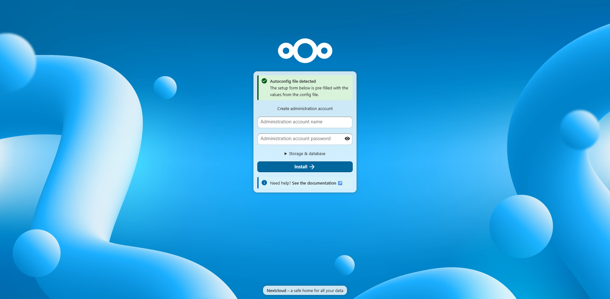

| `MYSQL_USER` | database and app | Names the database account that Nextcloud connects with. |
| `MYSQL_PASSWORD` | database and app | Sets and supplies the password for that database account. |
| `MYSQL_HOST` | app | Tells Nextcloud which hostname to connect to, which is the `database` service. |

---

## 🛠️ Deployment and Teardown Commands

| 💻 Command | 📋 What It Did |
|---|---|
| `docker-compose up -d` | Pulled both images, created the network, and started both containers in the background. |
| `docker-compose ps` | Listed the stack's containers and showed that both were in the Up state. |
| `docker-compose down` | Stopped and removed both containers and the stack's network. |

---

## 📝 Deviations From the Lab Spec

| 🔧 Item | 📋 Spec Said | ✅ What I Ran | 💡 Why |
|---|---|---|---|
| **🗄️ MariaDB image** | `mariadb:10.6` | `mariadb:11.8` | MariaDB 10.6 reached end of life on 6 July 2026, and Nextcloud 35 no longer supports it, so I used a currently supported release. |
| **📄 Version line** | `version: '3'` | Line omitted | The `version` line is optional in the Compose specification, and `docker-compose config` filled in a default value automatically. |

The KillerCoda Ubuntu 24.04 machine did not recognize `docker compose` (with a space). It has the standalone `docker-compose` command, version 1.29.2, so every Compose command in this lab uses the hyphenated form.

---

## 📸 Evidence

### 🚀 Stack Deployment

### 🌐 Nextcloud Setup Page on Port 8080

### 🧹 Stack Teardown

