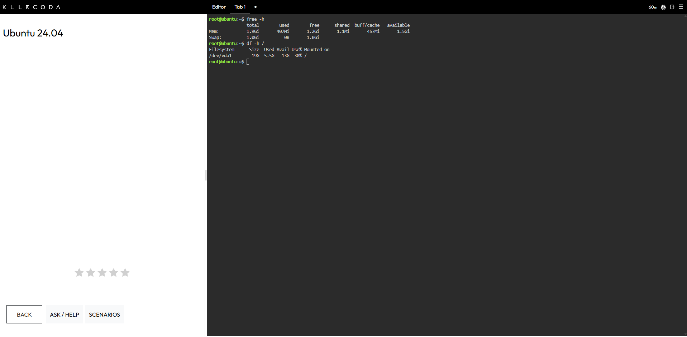
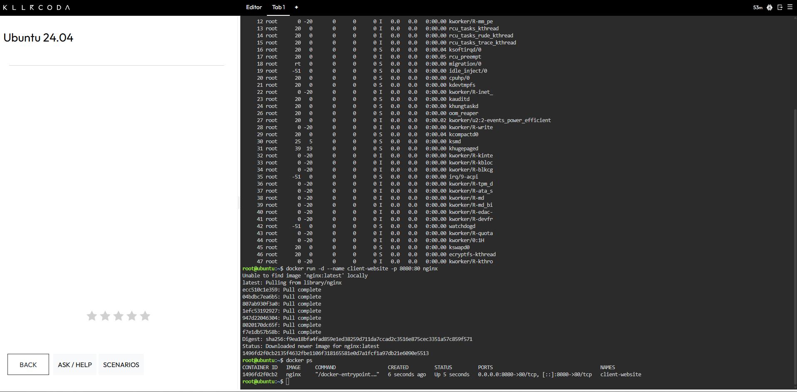
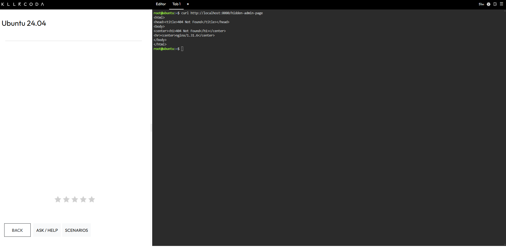

# ☁️ Laboratory 07: Cloud Operations Engineer

**CCM101 Cloud Computing | University of Eastern Pangasinan | Mission 7**

---

## 🎯 Mission Overview

CloudNova Technologies is preparing a large marketing campaign for a client's website, and the client is worried that the cloud servers will run out of memory when thousands of users visit at once. As a member of the Cloud Operations Team, I performed a baseline health check on the host server, deployed the client's Nginx web server, sent test traffic to it, and used logs and live metrics to check that the infrastructure is ready for the surge.

This lab is about observability. Instead of hoping the application works, I collected evidence from the host, from the container's logs, and from its real-time metrics.

---

## 📋 Objectives

- Use native Linux command-line tools to monitor host CPU, memory, and disk capacity.
- Deploy a web container and track its real-time performance using Docker metrics.
- Generate web traffic and extract application access logs for analysis.
- Translate raw performance data into a readable technical report using Markdown.
- Continue expanding a professional GitHub Cloud Computing Portfolio.

---

## 🧰 Monitoring Commands Executed

| 💻 Command | 📋 What It Did |
|---|---|
| `free -h` | Displayed the host's total, used, and available memory in readable units. |
| `df -h /` | Displayed the size, used space, and available space of the root file system. |
| `top` | Opened a live view of running processes and CPU load, which I watched for 5 seconds before exiting with q. |
| `docker run -d --name client-website -p 8080:80 nginx` | Started an Nginx container named `client-website` in the background and mapped host port 8080 to container port 80. |
| `docker ps` | Listed the running containers and confirmed that `client-website` was up. |
| `curl http://localhost:8080` | Sent a request to the home page, which I ran three times to simulate three visitors. |
| `curl http://localhost:8080/hidden-admin-page` | Requested a page that does not exist to trigger a 404 error. |
| `docker logs client-website` | Printed the container's application logs, which show the three 200 requests and the one 404 request. |
| `docker logs client-website 2>&1 \| grep " 404 "` | Filtered the logs down to the single line that records the 404 error. |
| `docker stats` | Displayed a live view of the container's CPU, memory, network, and disk use. |

**📝 Note on the traffic simulation:** while sending the three requests, a stray pasted line caused one `bash: syntax error` message in the terminal. It did not send any HTTP request, and the container logs confirm exactly three 200 responses and one 404 response.

---

## 📊 Key Findings

| 🔎 Area | 📌 Result |
|---|---|
| **🧠 Host RAM** | The host has 1.9 GiB of total memory, and about 407 MiB was in use at baseline. |
| **💽 Host Storage** | The root file system is 19 GB in size, with 5.5 GB used and 13 GB available. |
| **⚙️ Host CPU** | The host was about 99.3% idle with a load average of 0.00 at baseline. |
| **📜 Application Logs** | The container served three requests with status 200 and one request with status 404. |
| **📈 Container Metrics** | The `client-website` container used 2.738MiB of memory and 0.00% CPU while idle. |

These readings were taken while the system was idle, so they show a baseline and not how the server behaves under heavy load.

---

## 💡 Skills Learned

- Reading host memory, disk, and CPU health with `free`, `df`, and `top`.
- Deploying a named Nginx container with a port mapping using `docker run`.
- Generating test traffic and an intentional HTTP error with `curl`.
- Finding specific status codes in container logs with `docker logs` and `grep`.
- Reading real-time CPU, memory, and network figures with `docker stats`.
- Recording baseline measurements in clear Markdown reports with screenshots as evidence.
- Telling the difference between logs, which show what happened, and metrics, which show how hard the system is working.

---

## 📂 Deliverables

| 📄 File | 📋 Description |
|---|---|
| [system-baseline-report.md](system-baseline-report.md) | Records the host's RAM, storage, and CPU baseline. |
| [container-observability.md](container-observability.md) | Records the 404 log line and the container's memory and CPU use. |
| [reflection.md](reflection.md) | Mission reflection. |
| `screenshots/` | Evidence of the host checks, the deployment, the traffic, the logs, and the metrics. |

---

## 📸 Evidence

### 🧠 Memory Check

### 💽 Disk Check

### 🌐 Nginx Deployment

### 🟢 Successful Requests

### 🔴 Failed Request

### 📜 Container Logs

### 📊 Container Metrics

