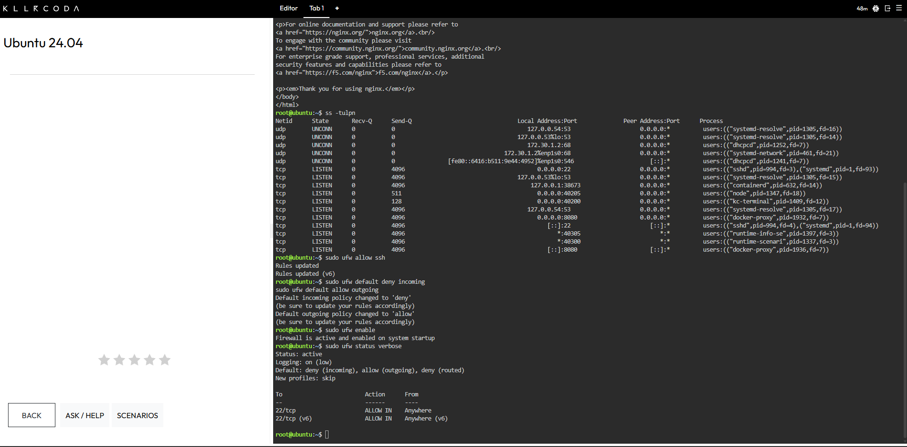
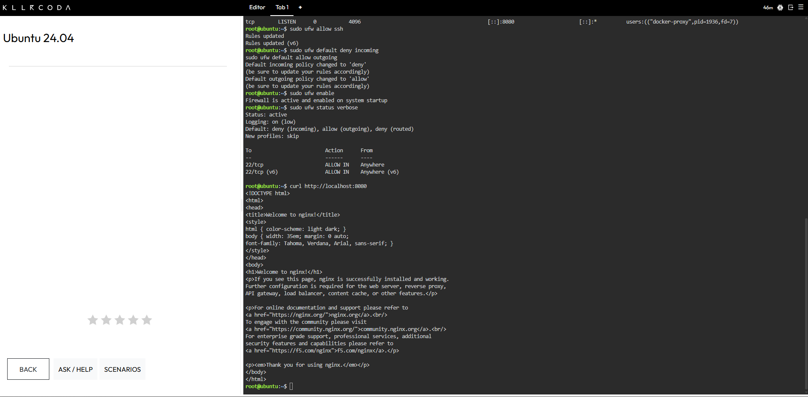
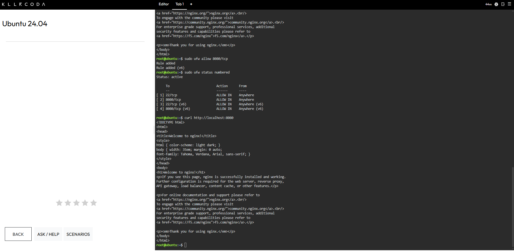

# 🛡️ Laboratory 08: Cloud Security Engineer

**CCM101 Cloud Computing | University of Eastern Pangasinan | Mission 8**

---

## 🎯 Mission Overview

A junior developer at CloudNova Technologies deployed a new Ubuntu server for a client's web application without configuring any network security. As a member of the Cloud Security Team, I secured the machine by auditing its open ports, enabling the Uncomplicated Firewall (UFW), enforcing a default deny policy for incoming traffic, and opening only the two services the client needs: SSH for remote administration and port 8080 for the web application.

This lab applies the defense in depth idea from Chapter 8. A host-based firewall adds a layer of protection on the server itself, and the same lab also showed me where that layer has limits when Docker is involved.

---

## 📋 Objectives

- Understand the concept of the Attack Surface and the Principle of Least Privilege (PoLP).
- Perform a basic security audit of active network ports on a Linux server.
- Configure the Uncomplicated Firewall (UFW) with a Default Deny policy.
- Implement granular port management to selectively allow SSH and HTTP traffic.
- Document firewall rules and security best practices using Markdown.
- Continue expanding a professional GitHub Cloud Computing Portfolio.

---

## 🧰 Commands Executed

| 💻 Command | 📋 What It Did |
|---|---|
| `docker run -d --name secure-web-app -p 8080:80 nginx` | Started an Nginx container named `secure-web-app` in the background and mapped host port 8080 to container port 80. |
| `docker ps` | Listed the running containers and confirmed that `secure-web-app` was up. |
| `curl http://localhost:8080` | Sent a request to the web application to confirm it was reachable. |
| `ss -tulpn` | Listed every TCP and UDP port the server was listening on, with the program behind each one. |
| `sudo ufw allow ssh` | Added a rule that permits incoming SSH traffic on port 22. |
| `sudo ufw default deny incoming` | Set the default policy to block all incoming traffic that no rule allows. |
| `sudo ufw default allow outgoing` | Set the default policy to allow the server's outgoing traffic. |
| `sudo ufw enable` | Activated the firewall and set it to start at boot. |
| `sudo ufw status verbose` | Displayed the firewall state, default policies, and rules. |
| `curl http://localhost:8080` | Tested the web application again while the firewall was active and port 8080 had no rule. |
| `sudo ufw allow 8080/tcp` | Added a rule that permits incoming TCP traffic on port 8080. |
| `sudo ufw status numbered` | Listed the firewall rules with numbers to confirm the new rule. |
| `curl http://localhost:8080` | Tested the web application once more with the 8080 rule in place. |

**📝 Note on the firewall test:** the `curl` request succeeded both before and after the 8080 rule was added, because it was sent from the server itself and Docker publishes its own ports. The details are in [firewall-configuration.md](firewall-configuration.md).

---

## 📊 Key Findings

| 🔎 Area | 📌 Result |
|---|---|
| **🔍 Baseline Ports** | Before hardening, SSH on port 22 and the Docker-published port 8080 were both listening on all addresses. |
| **🔥 Firewall State** | UFW was active, with a default deny policy for incoming traffic and a default allow policy for outgoing traffic. |
| **📜 Final Rules** | Four rules were active, which are SSH and port 8080 for both IPv4 and IPv6. |
| **🧪 Test Result** | The web page answered a local request before and after the 8080 rule, so the local test does not show what the rule blocks. |
| **🐳 Docker Note** | Docker-published ports can skip UFW's rules, so a deny rule alone may not hide such a port from the internet. |

---

## 💡 Skills Learned

- Explaining the Principle of Least Privilege, the attack surface, and a default deny policy.
- Auditing the listening ports on a Linux server with `ss -tulpn`.
- Enabling UFW safely by allowing SSH before turning the firewall on.
- Setting default incoming and outgoing policies with UFW.
- Opening a single port with a precise rule and checking it with `ufw status numbered`.
- Recognizing that a test from the server itself does not prove how outside traffic is handled.
- Learning that Docker-published ports can bypass UFW, and naming ways to close that gap.
- Documenting firewall rules and evidence clearly in Markdown.

---

## 📂 Deliverables

| 📄 File | 📋 Description |
|---|---|
| [security-audit-report.md](security-audit-report.md) | Defines PoLP, attack surface, and default deny, and records the baseline port audit. |
| [firewall-configuration.md](firewall-configuration.md) | Documents the UFW commands, the final rules, and the Docker observation. |
| [reflection.md](reflection.md) | Mission reflection. |
| `screenshots/` | Evidence of the application, the port audit, and each firewall stage. |

---

## 📸 Evidence

### 🌐 Application Running Before Hardening

### 🔍 Open Ports Before Hardening

### 🔥 Firewall Activated

### 🧪 Request Before the 8080 Rule

### 🌐 Port 8080 Allowed

