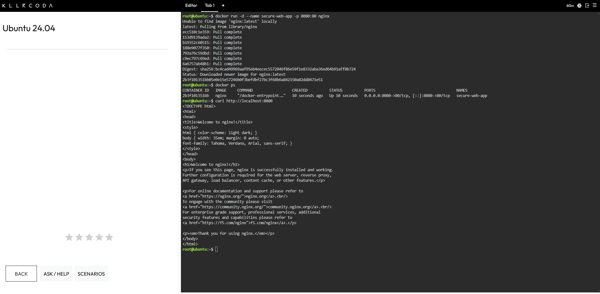
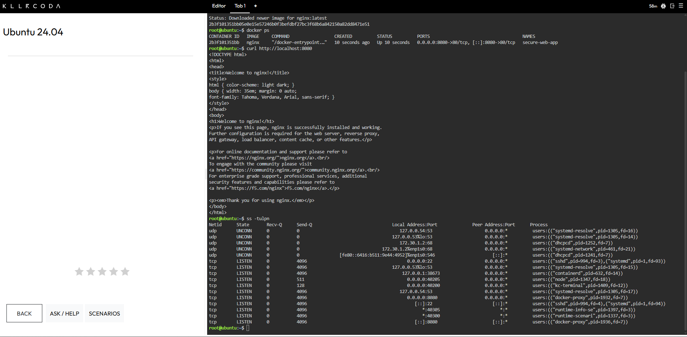

# 🛡️ Security Audit Report

> Core cloud security concepts behind the hardening of the CloudNova web server, documented before any changes were made to the live system.

---

## 📋 Overview

This report records the security principles that guide the lab, and it includes a baseline audit of the server's open network ports taken before any firewall rules were applied. Each concept below is defined in my own words, and the final table shows how each one is applied to the server in this mission.

---

## 🔑 The Principle of Least Privilege (PoLP)

The Principle of Least Privilege means giving every user, application, and service only the access it needs to do its job, and nothing more. In the cloud this matters because accounts are the main way into a system, so a stolen or misused account with broad rights can do far more damage than one with narrow rights. Limiting access keeps a single mistake or breach from spreading across the whole environment.

---

## 🎯 Attack Surface

The attack surface of a virtual machine is the total set of points where an attacker could try to get in. This includes open network ports, running services, installed software, and user accounts. The more of these that are exposed, the more chances an attacker has to find a weakness, so a smaller attack surface means a safer machine.

---

## 🚫 Default Deny Policy

A default deny policy blocks all incoming traffic unless a rule specifically allows it. This is safer than blocking attackers one by one, because it is impossible to know every hostile address in advance and new ones appear constantly. With default deny, anything that was forgotten or never planned for stays blocked, and only the exact doors that legitimate services need are opened.

---

## 🔍 Baseline Port Audit

Before configuring the firewall, I deployed the Nginx container `secure-web-app` on port 8080 and listed every port the server was listening on with `ss -tulpn`. This gives a record of the attack surface while the server was still fully exposed.

| 🔌 Port | 🧩 Service | 📋 What It Means |
|---|---|---|
| **22** | `sshd` | The SSH service was listening on all addresses, which is the door administrators use for remote management. |
| **8080** | `docker-proxy` | The Nginx container's published port was listening on all addresses, which is the door the client's users need. |
| **40200, 40205, 40300, 40305** | `kc-terminal`, `node`, `runtime-scenari`, `runtime-info-se` | These ports belong to processes whose names suggest they are part of the KillerCoda playground itself, and they also listen on all addresses. |
| **53, 68, 546** | `systemd-resolve`, `dhcpcd`, `systemd-network` | These are the server's own name resolution and network configuration services. |
| **38673** | `containerd` | The container runtime listened on the local address 127.0.0.1 only, so it was not reachable from outside the server. |

The audit shows that several services were listening on all addresses before any firewall existed. A firewall does not stop a program from listening, so these entries are expected to remain in `ss` output after hardening, and the firewall status in `firewall-configuration.md` is the evidence that unwanted incoming traffic is being blocked.

---

## 🧩 How These Concepts Apply to This Mission

| 🧠 Concept | 🛠️ Application in This Lab |
|---|---|
| **🔑 Principle of Least Privilege** | The firewall is configured to let in only SSH for administrators and port 8080 for the web application, so each service receives only the access it needs. |
| **🎯 Attack Surface** | The firewall is meant to shrink the exposed ports on the server down to the two that the client actually needs. |
| **🚫 Default Deny Policy** | The firewall is set to deny all incoming traffic by default and to allow outgoing traffic, with specific rules added afterward. |

---

## 🧰 Commands Used

| 💻 Command | 📋 What It Did |
|---|---|
| `docker run -d --name secure-web-app -p 8080:80 nginx` | Started an Nginx container named `secure-web-app` in the background with host port 8080 mapped to container port 80. |
| `docker ps` | Listed the running containers and confirmed that `secure-web-app` was up. |
| `curl http://localhost:8080` | Sent a request to the web server to confirm it was reachable. |
| `ss -tulpn` | Listed every TCP and UDP port the server was listening on, with the program behind each one. |

---

## 📸 Evidence

### 🌐 Application Running Before Hardening

### 🔍 Open Ports Before Hardening

