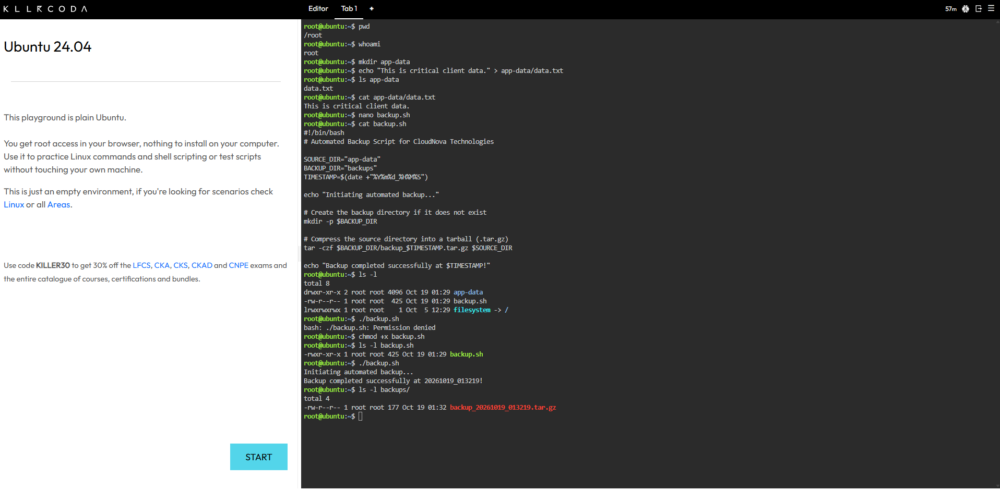
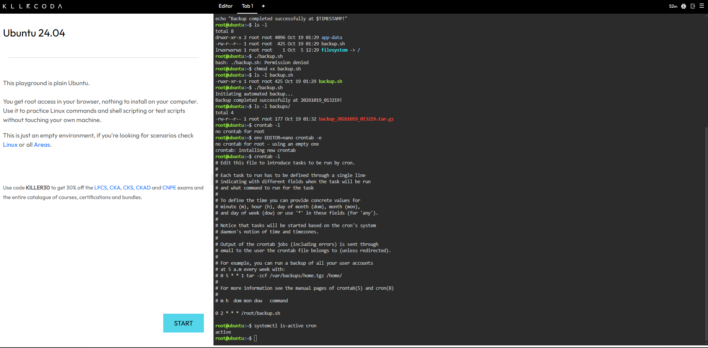

# ⚙️ Laboratory 09: Cloud Automation Engineer

**CCM101 Cloud Computing | University of Eastern Pangasinan | Mission 9**

---

## 🎯 Mission Overview

A client of CloudNova Technologies kept losing data because their IT staff forgot to back up their application files at the end of the week. As a member of the Cloud Automation and DevOps Team, I removed the human step from that process. I created a dummy application folder, wrote a Bash script that compresses it into a time-stamped backup, made the script executable, and scheduled it with cron to run every night at 2:00 AM.

This lab is the final chapter of my portfolio, and it follows one rule from the mission: if a task has to be done more than twice in the cloud, it should be automated.

---

## 📋 Objectives

- Understand the fundamental syntax of a Bash shell script, including variables and basic commands.
- Use a command-line text editor (nano) to write and save executable scripts.
- Modify Linux file permissions using the chmod command.
- Understand task scheduling and the syntax of a Linux crontab.
- Document automation code and Cron job configurations using Markdown.
- Complete the final chapter of my GitHub Cloud Computing Portfolio.

---

## 🧰 Commands Executed

| 💻 Command | 📋 What It Did |
|---|---|
| `pwd` | Printed the current folder, which was `/root`. |
| `whoami` | Confirmed that I was working as the `root` user. |
| `mkdir app-data` | Created the dummy folder that represents the client's application data. |
| `echo "This is critical client data." > app-data/data.txt` | Wrote a test sentence into a new file inside `app-data`. |
| `ls app-data` | Listed the folder to confirm that `data.txt` existed. |
| `cat app-data/data.txt` | Printed the test file to confirm its contents. |
| `nano backup.sh` | Opened the nano editor to write the backup script. |
| `cat backup.sh` | Printed the saved script to check that it was pasted correctly. |
| `ls -l` | Listed the files with their permissions, which showed `backup.sh` without the execute permission. |
| `./backup.sh` | Tried to run the script and received `Permission denied`. |
| `chmod +x backup.sh` | Added the execute permission to the script. |
| `ls -l backup.sh` | Confirmed that the permissions changed to `-rwxr-xr-x`. |
| `./backup.sh` | Ran the script, which created the backup and printed a success message. |
| `ls -l backups/` | Listed the backup folder and showed `backup_20261019_013219.tar.gz`. |
| `crontab -l` | Checked the existing cron jobs and returned `no crontab for root`. |
| `env EDITOR=nano crontab -e` | Opened the cron table in nano so I could add the schedule. |
| `crontab -l` | Displayed the installed schedule, which ended with `0 2 * * * /root/backup.sh`. |
| `systemctl is-active cron` | Confirmed that the cron service was running. |

---

## 📊 Key Findings

| 🔎 Area | 📌 Result |
|---|---|
| **📦 Backup Output** | The script created `backup_20261019_013219.tar.gz` inside a new `backups` folder. |
| **🔐 Permissions** | The script failed with `Permission denied` until `chmod +x` gave it the execute permission. |
| **⏰ Schedule** | The cron line `0 2 * * * /root/backup.sh` was installed for the root user. |
| **⚙️ Cron Service** | The cron service reported `active`, so no extra installation was needed. |

---

## 💡 Skills Learned

- Writing a Bash script with a shebang line, variables, comments, and command substitution.
- Using nano to create, paste into, and save a script from the terminal.
- Recognizing the `Permission denied` error and fixing it with `chmod +x`.
- Reading file permissions such as `-rw-r--r--` and `-rwxr-xr-x`.
- Compressing a folder into a time-stamped `.tar.gz` file with `tar`.
- Reading the five time fields of a cron expression and writing a nightly schedule.
- Installing a cron job with `crontab -e` and checking it with `crontab -l`.
- Documenting a script and a schedule so another team can understand them.

---

## 📂 Deliverables

| 📄 File | 📋 Description |
|---|---|
| [automation-research.md](automation-research.md) | Defines Bash scripts, variables, and cron jobs in my own words. |
| [backup-script-guide.md](backup-script-guide.md) | Documents the full script, the `chmod +x` command, and the cron expression. |
| [reflection.md](reflection.md) | Mission reflection. |
| `screenshots/` | Evidence of the script execution and the installed cron schedule. |

---

## 📸 Evidence

### ▶️ Script Execution and Backup File

### 📅 Installed Cron Schedule

